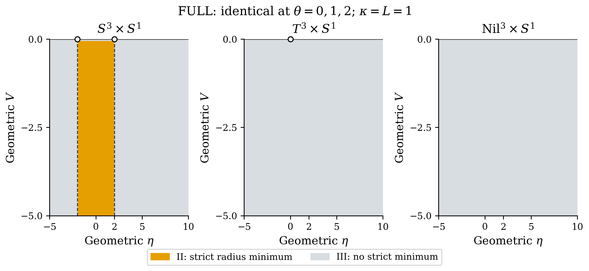

# DPPUv2 Paper 01: Geometry-Dependent Classification of Reduced Potentials in Einstein–Cartan Gravity

[日本語版 README](README_ja.md)

This repository provides supplementary materials for the paper, including the manuscript, sources, calculation code and figure data. The paper compares reduced potentials for static homogeneous geometries on $S^3\times S^1$, $T^3\times S^1$ and a compact $\mathrm{Nil}^3\times S^1$ quotient in Einstein–Cartan gravity.

On the stated ansatz, the complete Nieh–Yan (NY) density vanishes, so the FULL reduced potential is independent of the NY coupling. TT and positive-REE are separate diagnostic actions. The phase classification describes off-shell extrema along specified variation paths; a radius minimum does not establish a full vacuum solution, physical mass or decay rate.

## Paper version

**v3 — revised 2026-10-25.** The manuscript, figures and accompanying data correspond to v3. The changes from v2 to the action, torsion notation, global normalization and conclusions are summarized in the [revision history](CHANGELOG.md).

Repository DOI: [10.5281/zenodo.18213677](https://doi.org/10.5281/zenodo.18213677). When citing or comparing results, identify the manuscript version and files used.

[Correction tracking (Issue #4)](https://github.com/Muacca/DPPUv2-paper01/issues/4)

## Read the paper and data

| Resource | Contents |
|---|---|
| [English PDF](DPPUv2-paper01.pdf) | v3 paper with figures, tables and appendices |
| [Japanese Markdown](section_01_ja.md) | v3 paper; the introduction links to all chapters and appendices |
| [Figure and table data](data/paper_v3/README.md) | Numerical datasets, parameters, input domains and asset index |
| [LaTeX sources](LaTeX/main.tex) | Main file, sections and appendices |
| [Calculation code](script/) | Symbolic engines, topology runners, parameter scanner and visualization tools |
| [Conventions](script/docs/CONVENTIONS.md) | Connection, torsion, index and global-geometry conventions |
| [Independent NY calculation notebook](supplement/nieh_yan/README.md) | Optional exterior-algebra derivation of the NY identity, component coefficients and T/τ correspondence |



The displayed phase map uses geometric-torsion parameters. Definitions and variation paths are given in the paper.

## Use the calculation code

Run the following commands from the repository root, using a Python environment with the dependencies listed in [script/requirements.txt](script/requirements.txt).

```powershell
python -m pip install -r script/requirements.txt
python -B script/DPPUv2_parameter_scan_v3.py --help
```

A small scan example from Appendix F:

```powershell
python -B script/DPPUv2_parameter_scan_v3.py --topologies S3 --ny-variants FULL --V-min 1 --V-max 4 --V-points 2 --eta-min -3 --eta-max 3 --eta-points 7 --theta-min 0 --theta-max 1 --theta-points 2 --workers 1 --output-dir new_scan
```

The paper and figure datasets use geometric torsion $T$. The code input is $\tau=-T$, with $V_\tau=-V$ and $\eta_\tau=-\eta$. Thus the positive V inputs in this example correspond to negative V in the paper. Use the same torsion convention, global volumes and variation path when comparing calculations. Appendices A and C specify the parameter and domain maps; Appendix F describes reproduction.

CSV files are written to the selected directory as `dppu_scan_all_{timestamp}.csv` and `dppu_scan_{topology}_{ny_variant}_{timestamp}.csv`. The scanner output format differs from the figure datasets; see Appendix C and the [data guide](data/paper_v3/README.md).

Use a fresh output/checkpoint directory for each calculation and restart notebook or viewer kernels after changing code versions. The notebooks are supplied without evaluated outputs; see the [script guide](script/README.md) for their purpose and execution requirements. The v3 figure assets are in [LaTeX/figures/v3](LaTeX/figures/v3/), the tables in [LaTeX/tables/v3](LaTeX/tables/v3/), and the supporting datasets in [data/paper_v3](data/paper_v3/). For earlier results and their interpretation limits, see the [revision history](CHANGELOG.md#earlier-results).

## Build the PDF

Use a LaTeX installation providing `pdflatex` and the packages declared in [main.tex](LaTeX/main.tex). From the repository root, run:

```powershell
Push-Location LaTeX
pdflatex -interaction=nonstopmode -halt-on-error main.tex
pdflatex -interaction=nonstopmode -halt-on-error main.tex
pdflatex -interaction=nonstopmode -halt-on-error main.tex
Pop-Location
```

The repeated passes resolve cross-references and the table of contents. The output is `LaTeX/main.pdf`; inspect `LaTeX/main.log` for errors or unresolved references. These commands do not replace the supplied `DPPUv2-paper01.pdf` at the repository root.

## Author and license

Muacca. See [LICENSE](LICENSE) for the terms of use.

