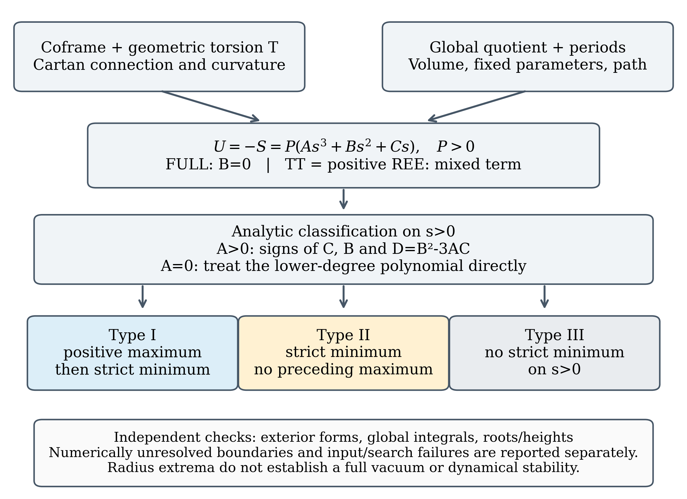

# 2. 作用・接続・変分の定義

## 2.1 coframeと添字規約

四次元Euclidean計量を$\delta_{ab}$とし、$a,b,c=0,1,2,3$、空間添字を$i,j,k=0,1,2$とする。正規直交coframe $e^a$と双対frame $E_a$について、向きを$\varepsilon_{0123}=+1$、体積形式を$\mathrm{vol}_4=e^0\wedge e^1\wedge e^2\wedge e^3$で定める。構造係数は式(M2-01)の正符号で定義する。

$$
de^a=\frac12 C^a{}_{bc}e^b\wedge e^c,\qquad
[E_b,E_c]=-C^a{}_{bc}E_a,\qquad
\omega^a{}_b=\Gamma^a{}_{bc}e^c.
$$

接続係数の最後の添字が微分方向である。計量適合性は$\Gamma_{abc}=-\Gamma_{bac}$を意味する。二形式の成分は式(M2-02)で固定する。

$$
\begin{aligned}
T^a&=de^a+\omega^a{}_b\wedge e^b
     =\frac12 T^a{}_{bc}e^b\wedge e^c,\\
R^a{}_b&=d\omega^a{}_b+\omega^a{}_c\wedge\omega^c{}_b
     =\frac12 R^a{}_{bcd}e^c\wedge e^d.
\end{aligned}
$$

## 2.2 接続の再構成

幾何学的torsionから接続を構成する式(M2-03)は次のとおりである。

$$
\begin{aligned}
\Gamma_{abc}&=\Gamma^{\mathrm{LC}}_{abc}+K_{abc}[T],\\
\Gamma^{\mathrm{LC}}_{abc}
 &=\frac12(C_{abc}+C_{cba}-C_{bac}),\\
K_{abc}[T]&=-\frac12(T_{abc}+T_{bca}-T_{cab}).
\end{aligned}
$$

この符号は式(M2-01)、(M2-02)および添字順序から決まる。実際に$T^a{}_{bc}=C^a{}_{bc}+\Gamma^a{}_{cb}-\Gamma^a{}_{bc}$を再構成すれば、指定した$T$に戻る。曲率は非座標基底の項を含む式(M2-04)で求める。

$$
R^a{}_{bcd}
=E_c(\Gamma^a{}_{bd})-E_d(\Gamma^a{}_{bc})
+\Gamma^a{}_{ec}\Gamma^e{}_{bd}
-\Gamma^a{}_{ed}\Gamma^e{}_{bc}
+\Gamma^a{}_{be}C^e{}_{cd}.
$$

対象ansatzは各固定スケールでframe成分が一定なので、最初の二つの微分項は零になる。スケールを変えた別の幾何との比較は、frame方向の微分とは別の操作である。

## 2.3 torsion ansatz

幾何学的torsionをaxial成分とvector成分の和で指定する。式(M2-05)で$s$は$S^3$の$r$、$T^3$の$R_1$、Nilの$R$であり、axial成分は空間添字だけに存在する。

$$
\begin{aligned}
T^{\mathrm{ax}}_{ijk}&=\frac{2\eta}{s}\varepsilon_{ijk},
&T^{\mathrm{ax}}_{ab3}&=T^{\mathrm{ax}}_{a3b}=T^{\mathrm{ax}}_{3ab}=0,\\
T^{\mathrm{vec}}_{abc}&=\frac13(\delta_{ac}V_b-\delta_{ab}V_c),
&V_a&=(0,0,0,V),\\
T_{abc}&=T^{\mathrm{ax}}_{abc}+T^{\mathrm{vec}}_{abc}.
\end{aligned}
$$

ここで$\eta,V$は符号を持つ実数であり、$T^\lambda{}_{\mu\lambda}=V_\mu$である。AXは$V=0$、VTは$\eta=0$、MXは両成分を許す場合を指す。数式上は零も含める。$V$を非負に限定することは幾何学的定義ではなく、入力領域の選択である。

縮約変分では$\eta,V$を固定する。したがってスケールを動かすとaxialのframe成分$2\eta/s$は変わる。この条件は、torsionの全frame成分を固定する変分とも、独立接続を自由に変分する問題とも異なる。

## 2.4 完全Nieh–Yan項と診断用作用

NY四形式とその密度を式(M2-06)で定義する。

$$
\begin{aligned}
\mathcal N&=d(e^a\wedge T_a)
=T^a\wedge T_a-e^a\wedge e^b\wedge R_{ab}
=n_{\mathrm{FULL}}\,\mathrm{vol}_4,\\
n_{\mathrm{TT}}&=\frac14\varepsilon^{abcd}T^e{}_{ab}T_{ecd},\\
n_{\mathrm{REE}}&=\frac12\varepsilon^{abcd}R_{abcd},\\
n_{\mathrm{FULL}}&=n_{\mathrm{TT}}-n_{\mathrm{REE}}.
\end{aligned}
$$

TTの$1/4$は二つのtorsion二形式の係数から、REEの$1/2$は一つの曲率二形式の係数から生じる。対象ansatzでは局所的に式(M2-07)が成立する。

$$
n_{\mathrm{TT}}=n_{\mathrm{REE}}=-\frac{4V\eta}{s},
\qquad n_{\mathrm{FULL}}=0.
$$

完全作用は式(M2-08)である。$\kappa^2>0$とし、$\theta$は時空上で定数とする。

$$
S_{\mathrm{FULL}}
=\int_M\frac{\mathcal R_{\mathrm{EC}}}{2\kappa^2}\,\mathrm{vol}_4
+\theta\int_M\mathcal N,\qquad U_{\mathrm{FULL}}=-S_{\mathrm{FULL}}.
$$

比較用に、$S_{\mathrm{TT}}=\int_M(\mathcal R_{\mathrm{EC}}/(2\kappa^2)+\theta n_{\mathrm{TT}})\mathrm{vol}_4$および$S_{\mathrm{REE}}=\int_M(\mathcal R_{\mathrm{EC}}/(2\kappa^2)+\theta n_{\mathrm{REE}})\mathrm{vol}_4$を定め、それぞれ$U=-S$とする。REE診断は**正符号**で曲率側を加える定義であり、完全NYの負の構成項を単独で取り出した作用とは符号が異なる。この定義のもとで、対象ansatzでは$U_{\mathrm{TT}}=U_{\mathrm{REE}}$である。

閉多様体上で$e^a\wedge T_a$が大域的かつ滑らかなら、Stokesの定理によって完全NYの積分は零である。ここではさらに密度そのものが零となる。境界・特異点・非定数結合を持つ問題には、この結論をそのまま移さない。

## 2.5 積分・次元・変分範囲

共通の円方向は$u\in[0,1)$、$e^3=L\,du$とし、$L>0$は実際の円周長である。作用にはこの円方向の積分も含める。長さを次元付きで扱うなら、$\eta$は無次元、$V$は長さの逆数、$\kappa^2$は長さの二乗であり、式(M2-08)を無次元作用とする$\theta$は長さの逆二乗である。従って$\kappa^2\theta$は無次元である。数値例の$\kappa=L=1$は基準単位を選んだ設定であり、それだけで$U$をPlanck質量と呼ぶことはできない。

主たる縮約経路は、$S^3$では$r$、Nilでは$R$、$T^3$では$R_i=r$または$R_2=\alpha R_1$、$R_3=\beta R_1$を動かす経路である。$\alpha,\beta>0$と$\eta,V,L,\kappa,\theta$を固定する。$T^3$の$R_2,R_3$固定経路は[付録E](appendix_E_ja.md)で別に扱う。

この代入後の一変数停留条件は、独立接続、全coframe、$L$、torsion係数に関するEuler–Lagrange方程式を置き換えない。後続では「半径極小」または「縮約極小」と呼び、全真空解とは区別する。

## 図表による整理

図1に対応する構成・曲線・分類を示す。

**図1：** 作用から半径相分類まで。局所接続と大域積分を別々に指定し、正のスケール上で解析分類する。数値未解像・入力エラーは物理相に含めない。
