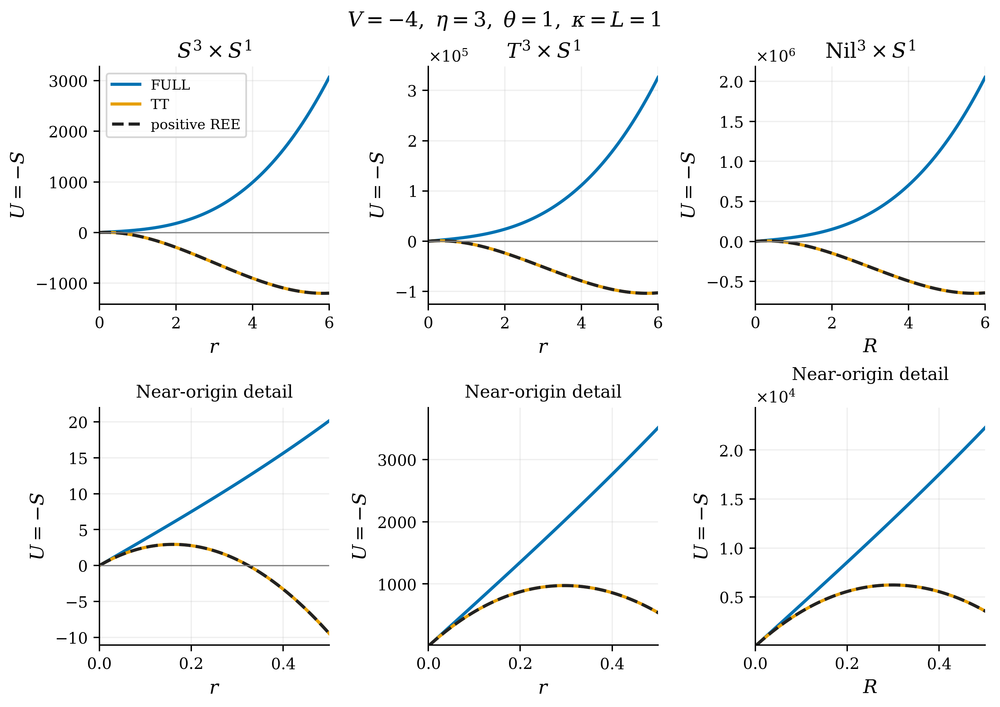
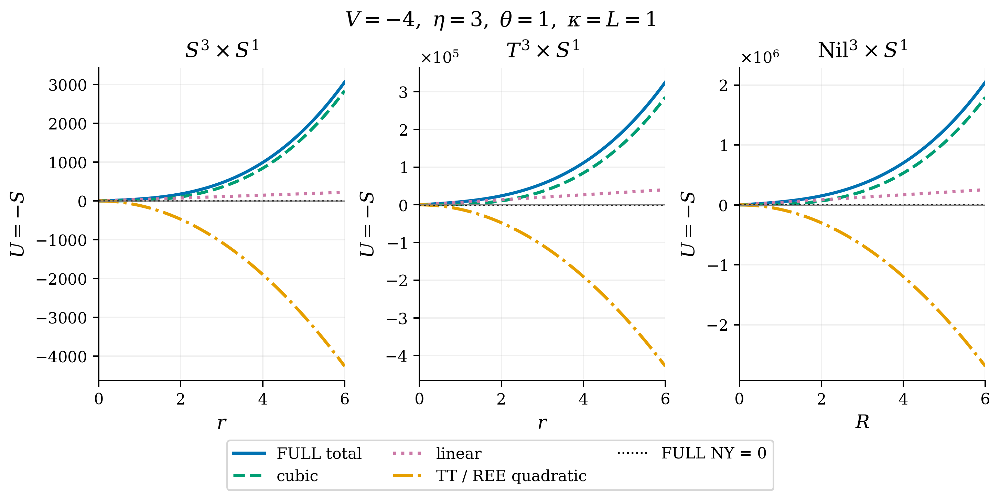

# 3. 大域幾何と縮約ポテンシャル

## 3.1 S³：構造係数と実半径

$S^3$を$SU(2)$と同一視する。Euler角を$\vartheta\in[0,\pi]$、$\varphi\in[0,2\pi)$、$\psi\in[0,4\pi)$とし、式(M3-01)の左不変形式を用いる。

$$
\begin{aligned}
\lambda^0&=\cos\psi\,d\vartheta+\sin\psi\sin\vartheta\,d\varphi,\\
\lambda^1&=-\sin\psi\,d\vartheta+\cos\psi\sin\vartheta\,d\varphi,\\
\lambda^2&=d\psi+\cos\vartheta\,d\varphi,\qquad
e^i=-\frac r4\lambda^i.
\end{aligned}
$$

境界では$(\varphi+2\pi,\psi)\sim(\varphi,\psi+2\pi)$とし、極での座標の退化を含む通常の$SU(2)$同定を用いる。三つのEuler角を独立な円として扱わない。このcoframeは$C^i{}_{jk}=4\varepsilon_{ijk}/r$を満たし、丸い球の実半径は$a=r/2$である。

coframeの向きに合わせた正の体積測度は$r^3\sin\vartheta\,d\vartheta\,d\varphi\,d\psi/64$となる。角座標の並びとcoframeの向きの符号を分けて扱う。円方向を含めた体積と局所不変量は式(M3-02)である。

$$
\begin{aligned}
\operatorname{Vol}(S^3)&=\frac{\pi^2r^3}{4}=2\pi^2a^3,\\
\operatorname{Vol}(S^3\times S^1)&=\frac{\pi^2Lr^3}{4},\\
\mathcal R_{\mathrm{LC}}&=\frac{24}{r^2}=\frac6{a^2},\\
\mathcal R_{\mathrm{EC}}&=\frac{24-6\eta^2}{r^2}-\frac23V^2.
\end{aligned}
$$

従って式(M3-03)を得る。

$$
\begin{aligned}
U^{S^3}_{\mathrm{FULL}}(r)
 &=\frac{\pi^2L}{12\kappa^2}
   \left[V^2r^3+(9\eta^2-36)r\right],\\
U^{S^3}_{\mathrm{TT}}(r)=U^{S^3}_{\mathrm{REE}}(r)
 &=\frac{\pi^2L}{12\kappa^2}
   \left[V^2r^3+12V\eta\kappa^2\theta r^2+(9\eta^2-36)r\right].
\end{aligned}
$$

実半径$a$でaxial成分を$2\chi/a$と書く場合は$\chi=\eta/2$も同時に変換する。式(M3-04)は$\chi$を固定した同じ経路である。

$$
U^{S^3}_{\mathrm{FULL}}(a)
=\frac{2\pi^2L}{3\kappa^2}
\left[V^2a^3+9(\chi^2-1)a\right].
$$

診断用作用には同じ括弧内に$12V\chi\kappa^2\theta a^2$を加える。$r$だけを$a$に読み替え、$\eta$の定義を据え置くことはしない。

## 3.2 T³：角周期と拡大経路

空間角$x^i\in[0,2\pi)$に対し、$e^{i-1}=R_i\,dx^i$とする。$R_i>0$はcoframeの係数であり、実際の周長は$\ell_i=2\pi R_i$である。構造係数とLevi–Civita曲率は零だが、torsionを含むEC曲率は一般に零ではない。式(M3-05)は

$$
\operatorname{Vol}(T^3\times S^1)=(2\pi)^3LR_1R_2R_3,\qquad
\mathcal R_{\mathrm{EC}}=-\frac{6\eta^2}{R_1^2}-\frac23V^2
$$

である。等方経路$R_i=r$では式(M3-06)となる。

$$
\begin{aligned}
U^{T^3}_{\mathrm{FULL}}(r)
 &=\frac{8\pi^3L}{3\kappa^2}\left[V^2r^3+9\eta^2r\right],\\
U^{T^3}_{\mathrm{TT}}(r)=U^{T^3}_{\mathrm{REE}}(r)
 &=\frac{8\pi^3L}{3\kappa^2}
   \left[V^2r^3+12V\eta\kappa^2\theta r^2+9\eta^2r\right].
\end{aligned}
$$

正の固定形状比$R_2=\alpha R_1$、$R_3=\beta R_1$では、$r=R_1$として全体に$\alpha\beta$を掛ける。半径方向の分類は保たれるが、形状変分に関する安定性は導かれない。周長$\ell_1$でaxial成分を$2\zeta/\ell_1$と表す場合には$\zeta=2\pi\eta$である。

## 3.3 Nil³：コンパクト商と格子

Heisenberg群$H$を積$(x,y,z)(x',y',z')=(x+x',y+y',z+z'+xy')$で定め、式(M3-07)を用いる。

$$
e^0=R\,dx,\qquad e^1=R\,dy,\qquad
e^2=R(dz-x\,dy),\qquad R>0.
$$

非零の構造係数は$C^2{}_{01}=-1/R$と$C^2{}_{10}=1/R$である。採用する空間は左商$\Gamma\backslash H$であり、格子を
$\Gamma=\{(2\pi j,2\pi k,4\pi^2l):j,k,l\in\mathbb Z\}$とする。
一般の格子周期$(a,b,c)$が積で閉じる条件$ab/c\in\mathbb Z$に対し、ここでは$(a,b,c)=(2\pi,2\pi,4\pi^2)$、$ab/c=1$となる。これによりcoframeが商へ降り、空間はコンパクトになる。

基本積分域は$x,y\in[0,2\pi)$、$z\in[0,4\pi^2)$である。面の同定は式(M3-08)のねじれを含む。

$$
(x,y,z)\sim(x+2\pi,y,z+2\pi y),\quad
(x,y,z)\sim(x,y+2\pi,z),\quad
(x,y,z)\sim(x,y,z+4\pi^2).
$$

したがって三方向を独立に周期化した直積トーラスではない。体積形式は$R^3dx\wedge dy\wedge dz$であり、基底二方向の周長は$2\pi R$、中心ファイバーの周長は$4\pi^2R$となる。この格子を固定して$R$を変分する。式(M3-09)は

$$
\begin{aligned}
\operatorname{Vol}(\mathrm{Nil}^3\times S^1)&=(2\pi)^4LR^3,\\
\mathcal R_{\mathrm{LC}}&=-\frac1{2R^2},\\
\mathcal R_{\mathrm{EC}}&=-\frac{1/2+6\eta^2}{R^2}-\frac23V^2
\end{aligned}
$$

となり、式(M3-10)を得る。

$$
\begin{aligned}
U^{\mathrm{Nil}}_{\mathrm{FULL}}(R)
 &=\frac{4\pi^4L}{3\kappa^2}
   \left[4V^2R^3+(36\eta^2+3)R\right],\\
U^{\mathrm{Nil}}_{\mathrm{TT}}(R)=U^{\mathrm{Nil}}_{\mathrm{REE}}(R)
 &=\frac{4\pi^4L}{3\kappa^2}
   \left[4V^2R^3+48V\eta\kappa^2\theta R^2+(36\eta^2+3)R\right].
\end{aligned}
$$

格子の選択は、局所構造係数だけから一意には決まらない。本稿では上記の商を定義の一部として固定する。この選択は体積$(2\pi)^4LR^3$を実現する具体的な大域幾何を与える。

## 3.4 共通構造

三幾何ともtorsionノルムは$T_{abc}T^{abc}=24\eta^2/s^2+2V^2/3$であり、NY密度は式(M2-07)である。共通スケールを$r$と略記すると、各ポテンシャルは$U=P(Ar^3+Br^2+Cr)$、$P>0$の形を持つ。完全作用では$B=0$、診断用作用では$B\propto V\eta\theta$となる。$C$には各幾何のLevi–Civita曲率の寄与が反映される。

体積規約を正の定数倍だけ変えた場合、同じ入力で$U$とその微分・高さは同じ倍率で変わるが、正半径の極値位置と分類は変わらない。実半径や周長への座標変更では、横軸とaxial係数の辞書も同時に適用する必要がある。

## 図表による整理

表1・2に本節の条件と値をまとめる。

図2・3に対応する構成・曲線・分類を示す。

**表1：** 局所曲率と大域正規化。$S^1$の座標周期は1、周長は$L$。Nilの面同定と格子は3.3節による。

| 空間 | スケール・周期 | $\mathcal R_{\rm LC}$ | 四体積 |
| --- | --- | --- | --- |
| $S^3$ | $a=r/2$ | $24/r^2$ | $\pi^2Lr^3/4$ |
| $T^3$ | $\ell_i=2\pi R_i$ | $0$ | $(2\pi)^3LR_1R_2R_3$ |
| $\mathrm{Nil}^3$ | $(a,b,c)=(2\pi,2\pi,4\pi^2)$ | $-1/(2R^2)$ | $(2\pi)^4LR^3$ |

**表2：** $U=P(As^3+Bs^2+Cs)$の係数。$s=r$（球面・等方トーラス）、$s=R$（Nil）。FULLでは$B=0$、$B_{\rm diag}$はTTと正符号REEに共通。

| 空間 | $P$ | $A$ | $B_{\rm diag}$ | $C$ |
| --- | --- | --- | --- | --- |
| $S^3$ | $\pi^2L/(12\kappa^2)$ | $V^2$ | $12V\eta\kappa^2\theta$ | $9\eta^2-36$ |
| $T^3$ | $8\pi^3L/(3\kappa^2)$ | $V^2$ | $12V\eta\kappa^2\theta$ | $9\eta^2$ |
| $\mathrm{Nil}^3$ | $4\pi^4L/(3\kappa^2)$ | $4V^2$ | $48V\eta\kappa^2\theta$ | $36\eta^2+3$ |

**図2：** 三幾何の作用比較。$V=-4,\eta=3,\theta=\kappa=L=1$。下段は原点近傍の拡大。FULLは全てtype-III、TTと正符号REEは一致してtype-Iとなる。横軸はcoframeの$r$（$S^3,T^3$）または$R$（Nil）であり、球面の実半径は$a=r/2$。縦軸は表1の体積を用いた作用である。

**図3：** 図2と同じ入力での項別分解。FULLは三次項と線形項の和であり、完全NY項は零である。橙線はTTまたは正符号REEの二次項であり、FULLには加えない。
