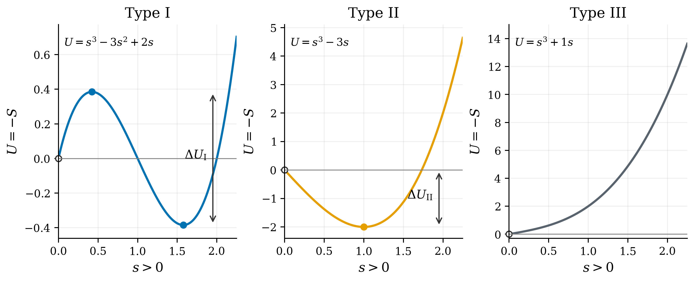
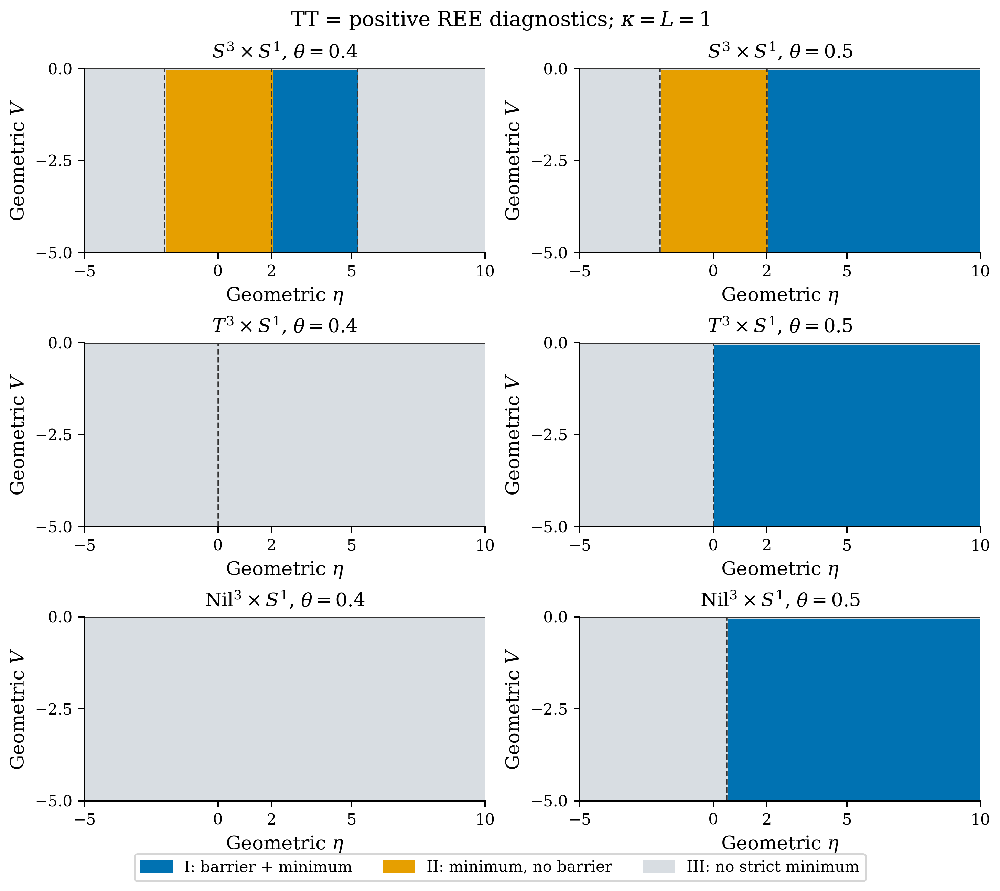
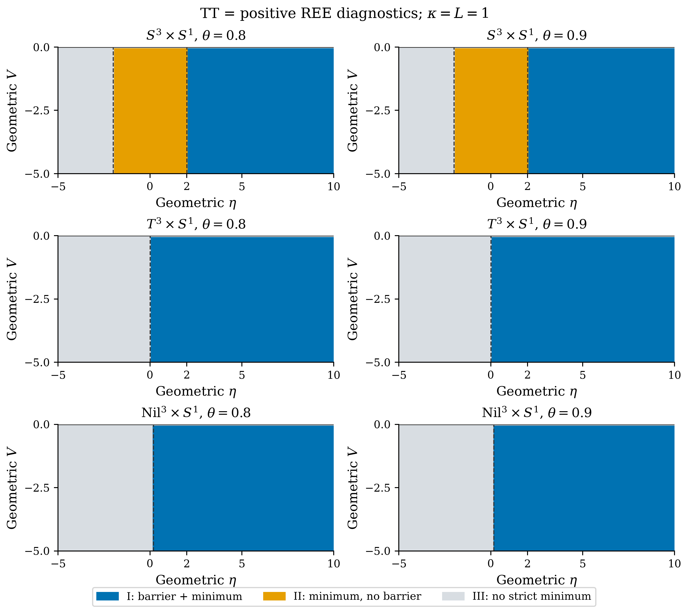

# 4. 極値の解析的分類

## 4.1 分類の定義

対象領域は正半径$r>0$である。type-Iは正の局所極大の後に厳密な局所極小が現れる場合、type-IIは先行する正の極大を伴わない厳密な局所極小がある場合、type-IIIは正半径の厳密な局所極小がない場合とする。type-IIIには単調増加、単調減少、runaway、平坦、停留変曲点を含むため、必要に応じてその内訳も記す。数値計算の失敗自体を物理的なtype-IIIの証拠とはしない。

三次式$U=P(Ar^3+Br^2+Cr)$、$P>0$、$A>0$について、式(M4-01)を用いる。

$$
U'=P(3Ar^2+2Br+C),\qquad
D=B^2-3AC,\qquad
r_\pm=\frac{-B\pm\sqrt D}{3A}.
$$

$D>0$のとき$U''(r_\pm)=\pm2P\sqrt D$であり、正の$r_+$が厳密な極小候補である。二次方程式の根の符号も合わせて判定することで、以下の必要十分条件を得る。

- $C<0$：常にtype-II。二根の積$C/(3A)$が負なので、正の根は$r_+$だけである。$B<0$を追加条件にする必要はない。
- $C=0$かつ$B<0$：type-II。$r_+=-2B/(3A)>0$であり、他方の根$r=0$は領域外である。
- $C>0$、$B<0$、$D>0$：type-I。$0<r_-<r_+$となる。
- それ以外：type-III。$D=0$で正の二重根があっても厳密な極小にはならない。

この分類は$r$の探索上限・下限に依存しない。$C>0$だけでは障壁付き極小の十分条件にならず、$B$の符号と判別式が不可欠である。

## 4.2 完全作用

$S^3$では$A=V^2$、$B=0$、$C=9\eta^2-36$である。$V\ne0$のとき式(M4-02)が成立する。

$$
\lvert\eta\rvert<2
\quad\Longleftrightarrow\quad
\text{type-II},\qquad
r_0=\frac{\sqrt{12-3\eta^2}}{\lvert V\rvert}.
$$

$\lvert\eta\rvert\ge2$では厳密な正半径極小はない。実半径では$a_0=r_0/2$、$\chi=\eta/2$を用い、存在条件は$\lvert\chi\rvert<1$となる。$\eta$の正負は対称であり、$\theta$は分類に現れない。

$T^3$の等方・固定形状経路では$C=9\eta^2\ge0$であるため、完全作用に厳密な極小はない。$(V,\eta)\ne(0,0)$では単調増加、両方零なら平坦である。Nilでは$C=36\eta^2+3>0$なので、全ての実$V,\eta$で単調増加する。

完全作用にtype-Iは存在しない。従って、このansatzに対してNY結合が障壁を作ることや、$\theta$の閾値によって完全作用が安定化することは主張しない。

## 4.3 TT・REE診断

診断用作用は同じ三次式を持ち、両者の分類は一致する。ただし完全作用とは異なる。

$S^3$で$V\ne0$の場合、$\lvert\eta\rvert<2$では$B$の符号にかかわらずtype-IIである。$\lvert\eta\rvert=2$では$V\eta\theta<0$の場合にtype-IIとなる。$\lvert\eta\rvert>2$では式(M4-03)がtype-Iの条件である。

$$
V\eta\theta<0,\qquad
16\eta^2\kappa^4\theta^2>3(\eta^2-4).
$$

$T^3$の等方・固定形状経路でtype-Iとなる条件は式(M4-04)である。

$$
V\eta\theta<0,\qquad
\kappa^2\lvert\theta\rvert>\frac{\sqrt3}{4}.
$$

Nilでtype-Iとなる条件は式(M4-05)である。

$$
V\eta\theta<0,\qquad
(64\kappa^4\theta^2-12)\eta^2>1.
$$

いずれも不等号は厳密である。境界の判別式零は極大・極小の合流であり、厳密な極小ではない。これらの閾値を完全NY作用に移用することはできない。

## 4.4 退化した係数と数値境界

このansatzで$A=0$となるのは$V=0$であり、そのとき$B=0$でもある。従って$U=PCr$を直接分類する。$S^3$では$\lvert\eta\rvert<2$で負方向へのrunaway、等号で平坦、$\lvert\eta\rvert>2$で単調増加となる。$T^3$では$\eta=0$で平坦、それ以外で増加、Nilでは常に増加する。

一般の三次式分類器は$A=0$、$B>0$、$C<0$という二次式にもtype-IIを返せるが、本稿のtorsion ansatzの$V=0$からその場合は生じない。

実装では丸め誤差を考慮して、$D$が$64\epsilon_{\mathrm{float}}\max(B^2,\lvert3AC\rvert)$以下なら、解像された厳密な極小なしとして扱う。数学的な$D=0$と、その近傍の数値的な未解像帯は同一ではない。解析的不等式が結論を与える場合はそれを優先し、数値出力のtype-IIIだけで境界近傍の厳密な不存在を証明したとはしない。

## 図表による整理

表3に本節の条件と値をまとめる。

図4・5・6・7に対応する構成・曲線・分類を示す。

**表3：** $P,A>0$の解析分類。$D=B^2-3AC$。$A=0$は低次多項式として扱う。

| 条件 | 相 | 正スケール上の極値 |
| --- | --- | --- |
| $C<0$ | II | 厳密な極小 |
| $C=0,\ B<0$ | II | 原点の停留点を除く極小 |
| $C>0,\ B<0,\ D>0$ | I | 極大の後に厳密な極小 |
| 上記以外 | III | 厳密な極小なし |

**図4：** 正スケール上の相分類の模式図。$P=1$とし、各多項式はパネル内に明記した。白丸の原点は定義域に含めない。type-Iの高さは正の極大から極小への差、type-IIは原点極限からの深さ。type-IIIは極小を持たない場合の一例である。

**図5：** FULLの相図。$\kappa=L=1$、幾何学的係数$V\in[-5,0],\eta\in[-5,10]$を0.1刻みで評価した。$\theta=0,1,2$の分類は同一。$S^3$のtype-IIは$V\ne0,\lvert\eta\rvert<2$のみ。破線$\eta=\pm2$と上辺$V=0$はtype-IIIであり、白丸は平坦例を表す。全幾何でtype-Iはない。

**図6：** TTと正符号REEの相図（$\theta=0.4,0.5$）。図5と同じ入力格子と$\kappa=L=1$を用いる。破線は式(M4-03)〜(M4-05)の解析境界であり、色のセル幅は0.1。上辺$V=0$は全てtype-III。$V<0$の球面では$\eta=2$もtype-IIに属し、$\eta=-2$はtype-IIIとなる。正の重根だけがある$D=0$はtype-IIIである。

**図7：** TTと正符号REEの相図（$\theta=0.8,0.9$）。入力域・格子・境界の扱いは図6と同じ。診断用作用のtype-I領域を、完全NY作用の結果へ読み替えない。
