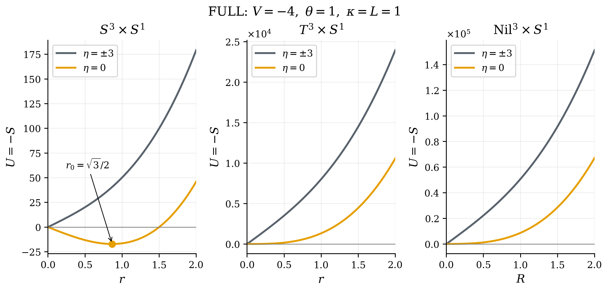
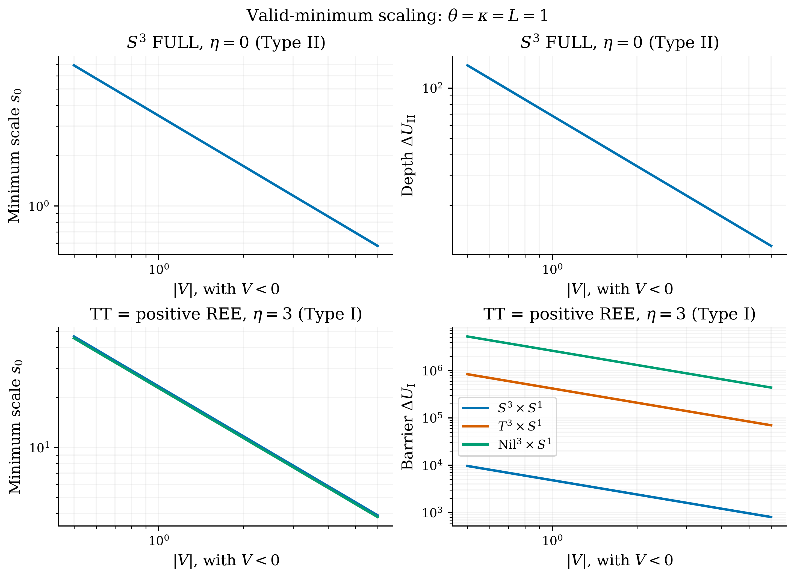

# 6. 代表条件とスケール依存

## 6.1 完全作用の代表条件

本章では、[第3章](section_03_ja.md)の式を代表条件で直接評価する。 $\kappa=L=1$ とし、本文の幾何学的torsion係数を用いる。

$S^3$ で $V=-4$ 、 $\eta=0$ とすると、任意の $\theta$ に対して式(M6-01)を得る。

$$
r_0=\frac{\sqrt3}{2},\qquad
a_0=\frac{\sqrt3}{4},\qquad
U(r_0)=-\sqrt3\thinspace \pi^2,\qquad
\Delta U_{\mathrm{II}}=\sqrt3\thinspace \pi^2.
$$

これはtype-IIであり、NYによる障壁はない。同じ $V$ で $\eta=\pm2$ では $U\propto r^3$ 、 $\eta=\pm3$ では線形係数も正となり、いずれも厳密な正半径極小はない。符号の片側だけにFULLの安定領域が生じることはない。

$T^3$ の等方経路では $V=-4,\eta=0$ で $`\mathcal R_{\mathrm{EC}}=-32/3`$ 、 $U=(128\pi^3/3)r^3$ となり、平坦なポテンシャルではない。Levi–Civita曲率が零という幾何の性質と、torsionを持つ接続の曲率を区別する。Nilも全ての実torsion係数で完全作用が単調増加する。

## 6.2 診断用作用の例

$V=-4,\eta=3,\kappa^2\theta=1$ では $V\eta\theta<0$ であり、三幾何とも診断用作用にtype-Iの条件が成立する。同じ接続・入力で完全作用を評価すると、三幾何とも厳密な正半径極小はない。この相違は、TTまたは正符号REEを単独で残したことによる作用の相違である。

$\eta=0$ または $V=0$ では混合項が零になるため、三つの作用は一致する。これは一般のMXでFULLとREEが一致することを意味しない。軸上の一致を作用全体の同一性へ拡張することはできない。

## 6.3 スケール則

$V\ne0$ とし、 $x=\lvert V\rvert r$ 、 $\sigma=\mathrm{sgn}(V)$ とおく。例えば $S^3$ の診断用作用は式(M6-02)となる。

$$
U^{S^3}_{\mathrm{TT}}
=\frac{\pi^2L}{12\kappa^2\lvert V\rvert}
\left[x^3+12\sigma\eta\kappa^2\theta x^2+(9\eta^2-36)x\right].
$$

$\eta,\kappa^2\theta,\sigma$ を固定すれば、存在する極値の半径は $1/\lvert V\rvert$ 、作用差も $1/\lvert V\rvert$ に比例する。 $T^3$ 等方とNilにも同様の代入ができる。係数から導かれるこのスケール則は、極小の存在条件を別途満たす場合にだけ極小や障壁のスケーリングとして解釈できる。

$\eta=3$ ではFULLに極小がないため、極小半径としてのスケール則は適用されない。 $V=0$ は上の変数変換の範囲外であり、線形の退化例として直接扱う。

## 図表による整理

表4に本節の条件と値をまとめる。

図8・9に対応する構成・曲線・分類を示す。

**表4：** 代表条件の解析値。 $V=-4,\theta=\kappa=L=1$ 。 $`s_0=r_0`$ または $`R_0`$ 。TTは正符号REEとも一致する。 $\Delta U$ はtype-Iでは障壁、type-IIでは原点極限からの深さ。極小なしは「---」で示す。

| 空間 | 作用 | $\eta$ | 相 | $`s_0`$ | $`U_{\min}`$ | $\Delta U$ |
| --- | --- | --- | --- | --- | --- | --- |
| $S^3$ | FULL | $3$ | III | --- | --- | --- |
| $S^3$ | FULL | $2$ | III | --- | --- | --- |
| $S^3$ | FULL | $0$ | II | $0.866025$ | $-17.0947$ | $17.0947$ |
| $S^3$ | FULL | $-3$ | III | --- | --- | --- |
| $S^3$ | TT | $3$ | I | $5.83945$ | $-1202.1$ | $1205.04$ |
| $T^3$ | FULL | $3$ | III | --- | --- | --- |
| $T^3$ | FULL | $2$ | III | --- | --- | --- |
| $T^3$ | FULL | $0$ | III | --- | --- | --- |
| $T^3$ | FULL | $-3$ | III | --- | --- | --- |
| $T^3$ | TT | $3$ | I | $5.70416$ | $-103666$ | $104640$ |
| $\mathrm{Nil}^3$ | FULL | $3$ | III | --- | --- | --- |
| $\mathrm{Nil}^3$ | FULL | $2$ | III | --- | --- | --- |
| $\mathrm{Nil}^3$ | FULL | $0$ | III | --- | --- | --- |
| $\mathrm{Nil}^3$ | FULL | $-3$ | III | --- | --- | --- |
| $\mathrm{Nil}^3$ | TT | $3$ | I | $5.70127$ | $-649133$ | $655365$ |

**図8：** FULLの代表曲線。 $V=-4,\theta=\kappa=L=1$ 。 $\eta=3,-3$ の曲線は重なる。 $\eta=0$ の球面だけに厳密な正半径極小があり、 $`r_0=\sqrt3/2`$ （実半径 $`a_0=\sqrt3/4`$ ）。数値は表4と対応する。

**図9：** 極小が存在する条件でのスケール依存。 $\theta=\kappa=L=1,V<0$ 、 $\lvert V\rvert\in[0.5,6]$ の121点。上段は球面FULL、 $\eta=0$ のtype-II極小と深さ、下段は三幾何の診断用作用、 $\eta=3$ のtype-I極小と障壁。いずれも $1/\lvert V\rvert$ に比例する。 $`s_0`$ は $`r_0`$ または $`R_0`$ であり、下段左では曲線が近接する。FULLの $\eta=3$ には極小がない。
